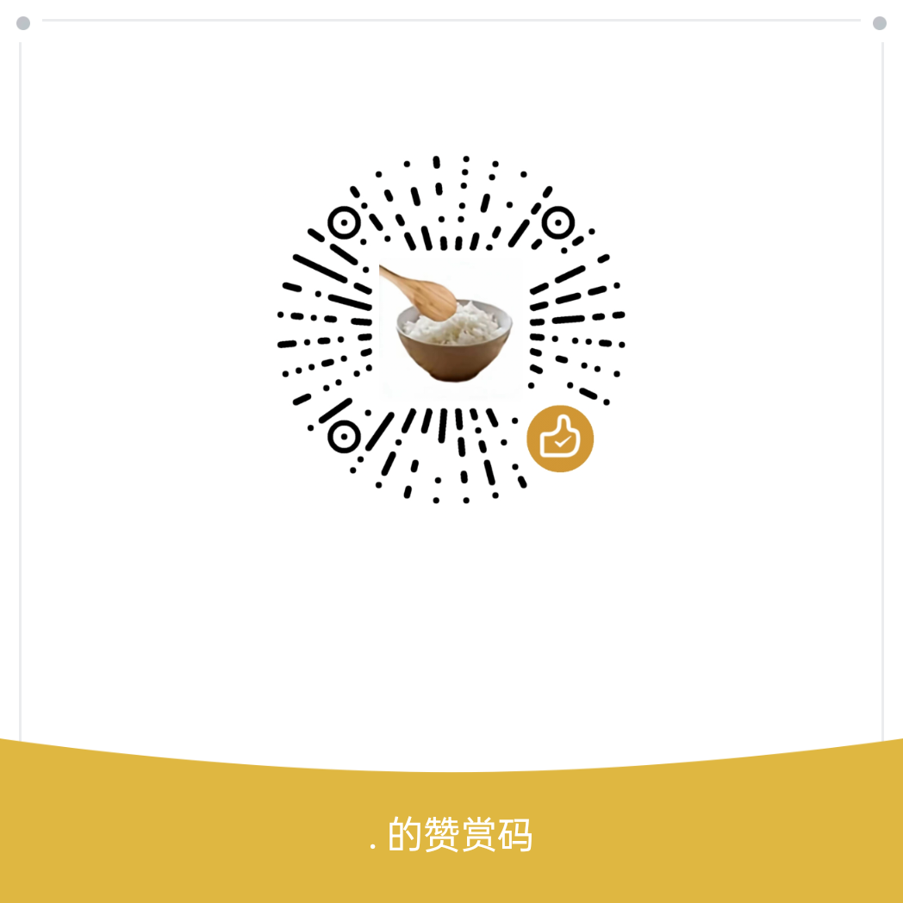

<div align="center">

# March7thAssistant Android Local

**在 Android 设备上原生运行的《崩坏：星穹铁道》自动化工具**

基于图像识别与 OCR，一键完成日常任务

[](LICENSE)
[](#-系统要求)
[](#-开发进度)

</div>

---

## ⚠️ 免责声明

**使用本项目前，请务必完整阅读本节。**

1. **本项目仅供学习与技术交流**，所有功能均基于虚拟屏、图像识别与 Shizuku / Root 提权实现，不修改游戏文件、不注入游戏进程、不修改游戏内存。

2. **使用自动化工具可能违反游戏用户协议，存在账号被封禁的风险。** 该风险由使用者**自行承担**，项目作者及贡献者**不承担任何责任**。

3. **请勿在米游社等官方社区讨论、宣传或分享本项目。** 这既会提高工具被检测的概率，也可能导致项目被下架，损害所有使用者的利益。

4. **本项目完全免费、开源。** 若你是通过付费渠道获得本工具，说明你被骗了，请立即申请退款并举报卖家。

5. **不对任何数据丢失、账号损失、设备损坏承担责任。**

6. 使用本项目即表示你**已阅读、理解并同意**以上全部条款。

---

## 📌 项目来源与致谢

本项目是**在他人优秀工作的基础上二次开发**的产物，并非从零开始。

### 上游项目

| 项目 | 作者 | 说明 |
|---|---|---|
| [**March7thAssistant**](https://github.com/moesnow/March7thAssistant) | [@moesnow](https://github.com/moesnow) | PC 版崩铁/原神自动化工具，本项目的**任务逻辑参考来源** |
| [**MAA-Meow**](https://github.com/Aliothmoon/MAA-Meow) | [@Aliothmoon](https://github.com/Aliothmoon) | 在 Android 上运行 MAA 的框架，本项目的**技术底座**（虚拟屏、特权服务、UI 框架） |

### 本项目的定位

上游的 MAA-Meow 是「在 Android 上跑**明日方舟**的 MAA」，本项目把内核**换成崩铁**：

- **保留**：工程结构、虚拟屏采集、Shizuku/KernelSU 特权服务、Compose UI、任务链框架
- **重写**：识别引擎（OpenCV 模板匹配 + ONNX OCR）、导航层、全部崩铁任务实现
- **参考**：March7thAssistant 的任务流程与判定逻辑

**没有这两个项目就没有本项目。请优先给上游点 Star。**

### 贡献者

本项目由 **[@biirekha857-star](https://github.com/biirekha857-star)** 发起并维护。

欢迎提交 Issue 与 Pull Request：

<a href="https://github.com/biirekha857-star/March7thAssistantAndroidlocal/graphs/contributors">
  
</a>

---

## ✨ 功能特性

### 后台运行（核心特性）

借助虚拟屏技术，游戏在**独立虚拟显示器**上运行，你可以同时用手机做别的事 —— 刷视频、聊天、看文档都不会被打断。

| 特性 | 说明 |
|---|---|
| 虚拟屏隔离 | 游戏运行在独立 display 上，不占用你的主屏幕 |
| 后台采集 | 直接从虚拟屏抓帧，无需前台切换 |
| 触摸注入 | 通过特权服务向虚拟屏注入触摸事件 |
| 实时预览 | App 内可放大查看虚拟屏画面，等比缩放不失真 |

### 自动化能力

| 能力 | 实现方式 |
|---|---|
| 图像识别 | OpenCV 模板匹配（多尺度 0.70~1.60，`TM_CCOEFF_NORMED`） |
| 文字识别 | PP-OCRv6（det + rec），ONNX Runtime 离线推理 |
| 区域识别 | 所有匹配/OCR 都限定在**小区域**内，比全屏快 5~20 倍 |
| 任务编排 | 可拖拽排序的任务链，支持定时执行 |

---

## 📱 系统要求

| 项 | 要求 |
|---|---|
| Android | **8.0 (API 26)** 及以上，推荐 **12+** |
| 架构 | **arm64-v8a** |
| 权限 | Root（KernelSU / Magisk）或 **Shizuku** |
| 存储 | 约 500 MB 可用空间 |
| 屏幕 | 支持任意比例；**长屏设备（2.2 比例）已做拉伸兼容** |

### 为什么需要特权服务

采集虚拟屏画面、向虚拟屏注入触摸事件，都需要 **shell / root 级权限**。
本项目提供两种后端：

- **Shizuku**（推荐）：无需 Root，通过 ADB 授权即可
- **Root**：KernelSU / Magisk，直接以 shell 身份运行

---

## 🚀 快速开始

```
① 安装 APK
② 授予 Shizuku 或 Root 权限
③ 首次启动会引导完成：
    · 用户协议确认（含风险提示）
    · 权限选择（Shizuku / Root）
    · 权限授予
④ 进入「任务」页，勾选要执行的日常任务
⑤ 点「开始任务」
```

### 首次运行前建议

- 关闭游戏的**省电优化**（系统设置 → 电池 → 本应用 → 不限制）
- 确保游戏已登录，并在**大厅**界面
- 若使用 Shizuku，保持 Shizuku 服务在运行

---

## 📋 开发进度

### 已实现且可用

| 任务 | 状态 | 说明 |
|---|---|---|
| **启动游戏** | ✅ 稳定 | 自动拉起游戏、点「点击进入」、处理列车补给公告、确认进入大厅 |
| **邮件** | ✅ 稳定 | 一键领取邮件附件 |
| **清体力** | ✅ 基本可用 | 支持全部 6 种副本类型，见下表 |
| **每日实训** | ✅ 可用（勾选式） | 委托、拍照、万能合成机、秘技、消耗体力、领奖 |
| **关闭游戏** | ✅ 稳定 | 结束游戏进程 |

### 清体力支持的副本

| 副本 | 单次消耗 | 单次连打上限 | 状态 |
|---|---|---|---|
| 拟造花萼（金） | 10 | 24 | ✅ |
| 拟造花萼（赤） | 10 | 24 | ✅ |
| 凝滞虚影 | 30 | 8 | ✅ |
| 侵蚀隧洞 | 40 | 6 | ✅ |
| 饰品提取（差分宇宙） | 40 | 6 | ✅ 含自由移动场景 |
| 历战余响（周本） | 30 | 3 | ✅ |

> 「饰品提取」是差分宇宙玩法，进入后有自由移动场景，程序会自动向前走并点攻击键触发战斗。

### 每日实训的实现方式

**不做任务列表 OCR 识别，改为用户勾选。**

原因：崩铁每个号每天的实训任务是随机抽取的。早期尝试复刻 PC 版的
「OCR 扫卡片 → 算分 → 补到 500」逻辑，但手游下极不可靠
（OCR 拆字跨卡片、「宇宙」认成「字画」、卡片布局随文字长度浮动）。

现在的做法：用户在配置面板勾选今天要做哪几项，程序按顺序执行，
每项做完回大厅确认，最后统一领奖。

### 开发中 / 规划中

| 项目 | 状态 | 说明 |
|---|---|---|
| 差分宇宙完整流程 | 🚧 规划 | 目前只有「走一步 → 攻击」，完整流程需处理祝福选择、层数推进 |
| 历战余响选择具体周本 | 🚧 规划 | 目前取列表第一个 |
| 锄大地 / 模拟宇宙 | 📋 未开始 | 优先级较低 |
| 成就、忘却之庭 | 📋 未开始 | — |

### 已知问题

| 问题 | 影响 | 状态 |
|---|---|---|
| 长屏设备（2.2 比例）画面拉伸 | 高 | 🔧 已有兼容修复，待验证 |
| 部分角色攻击键位置不同 | 中 | 使用固定坐标，若失效需调整 |
| 周本次数动态上限 | 低 | 已跳过次数验证 |

---

## 🛠 从源码构建

### 环境要求

| 组件 | 版本 |
|---|---|
| JDK | 17+ |
| Android SDK | compileSdk **37** |
| **NDK** | **29.0.14206865**（必需，编译 `libbridge.so`） |
| CMake | 3.22.1 |
| 内存 | **建议 8 GB 可用**，低于此值 R8 易卡死 |

### 构建步骤

```bash
# 1. 安装 NDK（必需）
sdkmanager --install "ndk;29.0.14206865"

# 2. 配置签名（可选，不配则 release 不签名）
# 在 local.properties 里写：
#   KEYSTORE_PATH=/path/to/your.jks
#   KEYSTORE_PASSWORD=***
#   KEY_ALIAS=***
#   KEY_PASSWORD=***

# 3. 构建
./gradlew :app:assembleDebug      # 调试版
./gradlew :app:assembleRelease    # 发布版
```

### R8 强度可配

在 `local.properties` 里设置：

```properties
# none  = 不混淆（开发调试，最快）
# light = 只混淆代码不压资源（开源发布，默认）
# full  = 全量混淆+资源压缩（上架商店，需 16GB 内存）
maa.r8=light
```

> ⚠️ **`libbridge.so` 的 JNI 类名不能被混淆**，`proguard-rules.pro` 里已用
> `-keep class ... { *; }` 锁定。改成 `{ native <methods>; }` 会导致
> `UnsatisfiedLinkError: JNI_ERR returned from JNI_OnLoad`。

---

## 🤝 参与开发

想新增任务或修改识别逻辑？请先阅读：

- **[任务开发规范](docs/TASK_DEVELOPMENT.md)** — 新增任务的标准流程、识别策略、调试方法

### 快速规范摘要

1. **优先区域识别**，不要全屏扫（性能差 5~20 倍）
2. **能用模板匹配就别用 OCR**，OCR 有拆字/误识风险
3. **按钮位置固定时直接写坐标**，比识别更可靠
4. **禁用 BACK 键**，会触发游戏的「是否退出」对话框
5. **每个动作后确认界面状态**，不要连续盲操作

---

## 📄 许可证

本项目基于上游 [MAA-Meow](https://github.com/Aliothmoon/MAA-Meow) 二次开发。

上游采用 **AGPL-3.0**，AGPL 要求**衍生作品必须沿用同一许可证**，
因此本项目同样以 [**AGPL-3.0**](LICENSE) 发布。

```
Copyright (C) MAA-Meow contributors
Copyright (C) M7A Android Local contributors

This program is free software: you can redistribute it and/or modify
it under the terms of the GNU Affero General Public License as published
by the Free Software Foundation, either version 3 of the License, or
(at your option) any later version.
```

### AGPL 对你的实际影响

| 场景 | 要求 |
|---|---|
| 自己用、自己改 | ✅ 随便用，不公开也行 |
| 分发修改版 | 必须开源，且同样用 AGPL |
| **作为网络服务提供** | 必须向用户提供完整源码（这就是 AGPL 比 GPL 严格的地方） |

> 若你只需要 GPL-3.0 的宽松度，需要先联系上游作者获得授权。

---

## 🔗 相关链接

- **本项目仓库**：https://github.com/biirekha857-star/March7thAssistantAndroidlocal
- **上游框架**：[MAA-Meow](https://github.com/Aliothmoon/MAA-Meow)
- **任务逻辑参考**：[March7thAssistant](https://github.com/moesnow/March7thAssistant)
- **问题反馈**：在本仓库提 [Issue](https://github.com/biirekha857-star/March7thAssistantAndroidlocal/issues)

---

## ☕ 赞赏支持

本项目**完全免费、开源**，没有任何付费功能或内购。

如果它确实帮到了你，欢迎请作者喝杯奶茶 —— **纯属自愿，不赞赏也完全不影响使用**。

<div align="center">



<sub>扫码赞赏（微信 / 支付宝）</sub>

</div>

> ⚠️ **再次强调：本项目不会因为赞赏而提供任何额外功能、优先支持或特殊待遇。**
> 如果你是通过付费渠道拿到本工具的，说明你被骗了 —— 请立即退款并举报卖家。

---

<div align="center">

**如果这个项目对你有帮助，请给一个 ⭐ Star**

*本项目仅供学习交流，请勿用于商业用途*

</div>
