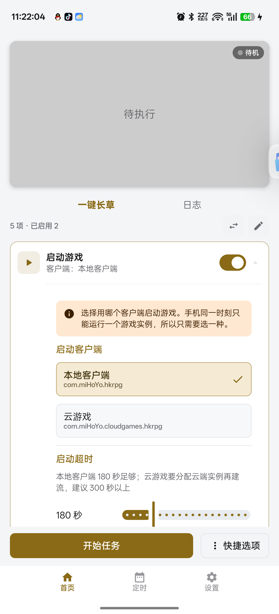
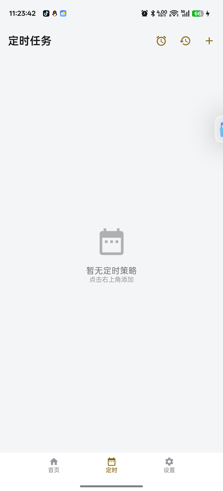
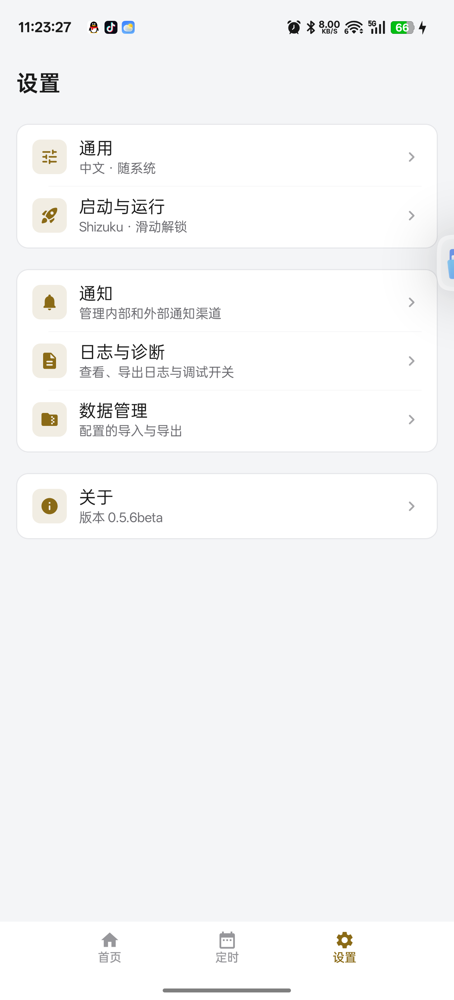
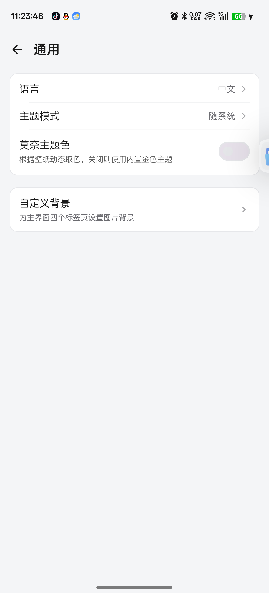

<div align="center">
  <h1 align="center">
    
    <br/>
    March7thAssistant<br/>
    <sub>Android Local</sub>
  </h1>
</div>

<div align="center">

🌟 Star this repo and GitHub will notify you about new releases.

</div>

<br/>

<div align="center">

[简体中文](./README.md) ｜ **English** ｜ [Getting Started](#-getting-started) ｜ [Known Issues](#known-issues) ｜ [Report a Bug](https://github.com/biirekha857-star/March7thAssistantAndroidlocal/issues)

Android 8.0+ · arm64-v8a · Shizuku / Root

</div>

<br/>

> ⚠️ This project runs on a virtual display with image recognition. It never modifies game files or injects into the game process. **Using automation tools may violate the game's terms of service and put your account at risk.** Full terms in [Disclaimer](#-disclaimer).

## Features

- **Background execution** — the game runs on a separate virtual display, so you can keep using your phone for anything else
- **Daily routines** — launch game, claim monthly pass, mail, stamina farming, daily training, close game
- **Stamina farming** — Calyx (Golden/Crimson), Stagnant Shadow, Cavern of Corrosion, Ornament Extraction and Echo of War; all 6 instance types supported
- **Daily training** — pick the items yourself instead of unreliable task-card OCR
- **Task chain** — card-based list with drag-to-reorder, inline configuration and scheduled runs
- **Live preview** — scaled preview of the virtual display, with letterboxing on tall screens
- **Logs & diagnostics** — timeline logs plus one-tap log bundle export
- **Touch self-healing** — failed injections clear stale gestures and retry with a fallback mode

## Screenshots

<p align="center">
  
  
  
  
</p>

Left to right: tasks (preflight + card list) · schedules · settings · settings detail

## Notes

- Check [Known Issues](#known-issues) first, then open an [Issue](https://github.com/biirekha857-star/March7thAssistantAndroidlocal/issues) with a log bundle from **Settings → Logs & Diagnostics → Export**
- [PRs](https://github.com/biirekha857-star/March7thAssistantAndroidlocal/pulls) are welcome — please read the [task development guide](docs/TASK_DEVELOPMENT.md) first
- **Do not discuss or promote this project on official community channels**
- This project is free and open source; any paid listing is unrelated to the author

## Download

Grab the APK from [Releases](https://github.com/biirekha857-star/March7thAssistantAndroidlocal/releases/latest).

> **arm64-v8a** only. Android 8.0 or newer is required.

## 🚀 Getting Started

```
1. Install the APK
2. Grant Shizuku or Root
3. The first launch walks you through:
    · Terms of use (with risk notice)
    · Privilege backend (Shizuku / Root)
    · Permission grant
4. On the Home tab, tick the tasks you want in the task cards
5. Tap "Start"
```

Before the first run:

- Disable battery optimization for this app (Settings → Battery → Unrestricted)
- Make sure the game is logged in and sitting in the lobby
- Keep the Shizuku service running if you use Shizuku

## 📱 Requirements

| Item | Requirement |
|---|---|
| Android | **8.0 (API 26)** or newer, **12+** recommended |
| ABI | **arm64-v8a** |
| Privilege | Root (KernelSU / Magisk) or **Shizuku** |
| Storage | ~500 MB free |
| Display | Any aspect ratio; letterboxing applied on tall screens |

### Why privileged access is needed

Capturing the virtual display and injecting touch events both require **shell / root** privileges. Two backends are supported:

- **Shizuku** (recommended): no root, granted over ADB
- **Root**: KernelSU / Magisk, running as shell directly

## 📋 Status

### Implemented

| Task | Status | Notes |
|---|---|---|
| **Launch game** | ✅ Stable | Starts the game, taps "Tap to enter", claims the monthly pass, dismisses the reward screen, confirms the lobby |
| **Mail** | ✅ Stable | Claims all mail attachments in one go |
| **Stamina farming** | ✅ Usable | All 6 instance types, see below |
| **Daily training** | ✅ Usable (manual selection) | Commissions, photos, synthesizer, technique, stamina spending, rewards |
| **Close game** | ✅ Stable | Kills the game process |

### Supported instances

| Instance | Cost per run | Max runs | Status |
|---|---|---|---|
| Calyx (Golden) | 10 | 24 | ✅ |
| Calyx (Crimson) | 10 | 24 | ✅ |
| Stagnant Shadow | 30 | 8 | ✅ |
| Cavern of Corrosion | 40 | 6 | ✅ |
| Ornament Extraction (Divergent Universe) | 40 | 6 | ✅ includes free-movement scene |
| Echo of War (weekly) | 30 | 3 | ✅ |

> Ornament Extraction takes place in Divergent Universe. The free-movement scene is handled by walking forward and tapping attack.

### Why daily training is manual

**Task cards are not OCR'd; you tick the items yourself.**

Daily training items are randomly assigned per account. The PC version scans the cards, scores them and tops up to 500 points — on mobile that proved unreliable (OCR splits text across cards, "universe" is misread, card layout shifts with text length).

Instead, you tick what you want today, the app runs them in order, returns to the lobby after each item, and claims rewards at the end.

### Planned

| Item | Status | Notes |
|---|---|---|
| Full Divergent Universe flow | 🚧 Planned | Only "walk → attack" today; blessings and floor progression pending |
| Weekly boss selection | 🚧 Planned | Currently picks the first entry |
| Farming routes / Simulated Universe | 📋 Not started | Low priority |
| Achievements, Memory of Chaos | 📋 Not started | — |

### Known Issues

| Issue | Impact | Status |
|---|---|---|
| Attack button position varies per character | Medium | Fixed coordinates; adjust if broken |
| Weekly run limit is dynamic | Low | Limit check skipped |
| Occasional touch injection failures | Medium | 🔧 Self-healing and fallback retries added, needs more samples |

## 🛠 Building from Source

### Requirements

| Component | Version |
|---|---|
| JDK | 17+ |
| Android SDK | compileSdk **37** |
| **NDK** | **29.0.14206865** (required, builds `libbridge.so`) |
| CMake | 3.22.1 |
| RAM | **8 GB free recommended**; R8 may stall below that |

### Build

```bash
# 1. Install the NDK (required)
sdkmanager --install "ndk;29.0.14206865"

# 2. Signing config (optional; release stays unsigned without it)
# Put these in local.properties:
#   KEYSTORE_PATH=/path/to/your.jks
#   KEYSTORE_PASSWORD=***
#   KEY_ALIAS=***
#   KEY_PASSWORD=***

# 3. Build
./gradlew :app:assembleDebug      # debug
./gradlew :app:assembleRelease    # release
```

### Configurable R8 level

In `local.properties`:

```properties
# none  = no obfuscation (fastest for development)
# light = obfuscate code only (default for open-source releases)
# full  = full obfuscation + resource shrinking (store builds, needs 16 GB RAM)
maa.r8=light
```

> ⚠️ The JNI class names used by `libbridge.so` **must not be obfuscated**. `proguard-rules.pro`
> pins them with `-keep class ... { *; }`. Narrowing that to `{ native <methods>; }` causes
> `UnsatisfiedLinkError: JNI_ERR returned from JNI_OnLoad`.

## 🤝 Contributing

Adding a task or changing recognition logic? Read the [task development guide](docs/TASK_DEVELOPMENT.md) first.

### Rules of thumb

1. **Prefer region-based recognition** — never scan the whole screen (5–20× slower)
2. **Template matching beats OCR** whenever possible; OCR misreads and splits text
3. **Hardcode coordinates for fixed buttons** — more reliable than recognition
4. **BACK is a last resort**: tap ✕ or the dialog's own cancel first; after any BACK, check for the "exit game" dialog and cancel it
5. **Verify the screen after every action** — never chain blind taps
6. **Only tap safe empty spots as a fallback** — never the back button, avatar, right-side dock or bottom primary button

## Related Projects

This project would not exist without the following open-source work:

- [March7thAssistant](https://github.com/moesnow/March7thAssistant) — PC automation for Honkai: Star Rail, the **source of task logic**
- [MAA-Meow](https://github.com/Aliothmoon/MAA-Meow) — the Android MAA framework, the **technical foundation** (virtual display, privileged service, UI framework)
- [RapidOCR](https://github.com/RapidAI/RapidOCR) — OCR models
- [OpenCV](https://opencv.org/) — template matching and image processing

MAA-Meow runs **Arknights** automation on Android; this project swaps the core for **Honkai: Star Rail**. The project structure, virtual display capture, Shizuku / KernelSU privileged service, Compose UI and task-chain framework are kept; the recognition engine, navigation layer and all game tasks were rewritten.

**Please star the upstream projects first.**

## 📄 Disclaimer

1. This project is for **learning and technical exchange** only. Everything is built on a virtual display, image recognition and Shizuku / Root; no game files are modified, no process injection, no memory editing.
2. **Automation tools may violate the game's terms of service and risk account penalties.** You accept that risk yourself; the author and contributors take no responsibility.
3. **Do not discuss or promote this project on official community channels.**
4. This project is free and open source. If you paid for it, you were scammed — ask for a refund and report the seller.
5. No liability for data loss, account loss or device damage.
6. Using this project means you have read, understood and accepted the above.

## License

This project is derived from [MAA-Meow](https://github.com/Aliothmoon/MAA-Meow), which is licensed under **AGPL-3.0**. AGPL requires derivatives to keep the same license, so this project is released under [**AGPL-3.0**](LICENSE) as well.

| Scenario | Requirement |
|---|---|
| Personal use / modification | ✅ No obligation to publish |
| Distributing modified builds | Must open source under AGPL |
| Offering it as a network service | Must provide the full source to users |

---

## ☕ Support

This project is **free and open source**, with no paid features. If it helped you, you can buy the author a coffee — **entirely optional**.

<div align="center">


</div>

> ⚠️ Donations never buy extra features, priority support or special treatment.

## Contributors

<a href="https://github.com/biirekha857-star/March7thAssistantAndroidlocal/graphs/contributors">
  
</a>

## Stargazers over time

<a href="https://star-history.com/#biirekha857-star/March7thAssistantAndroidlocal&Date">
 <picture>
   <source media="(prefers-color-scheme: dark)" srcset="https://api.star-history.com/svg?repos=biirekha857-star/March7thAssistantAndroidlocal&type=Date&theme=dark" />
   <source media="(prefers-color-scheme: light)" srcset="https://api.star-history.com/svg?repos=biirekha857-star/March7thAssistantAndroidlocal&type=Date" />
   
 </picture>
</a>
